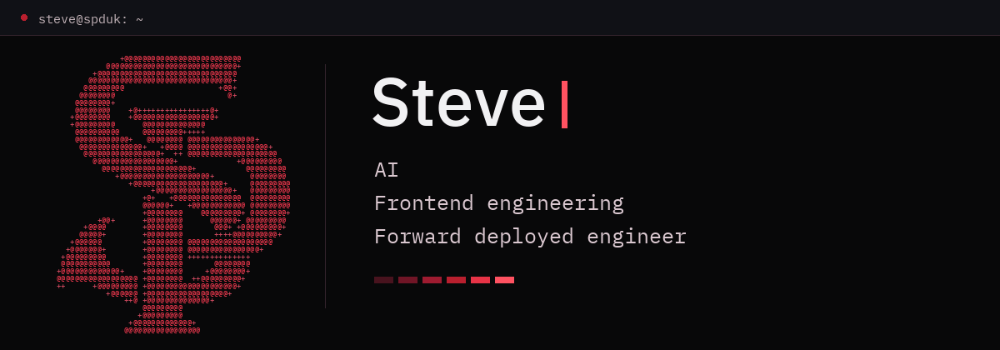
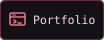
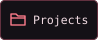
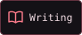

<a href="https://spdevuk.com/">
  <picture>
    <source media="(max-width: 600px) and (prefers-reduced-motion: reduce)" srcset="assets/header-mobile.png">
    <source media="(max-width: 600px)" srcset="assets/header-mobile.gif">
    <source media="(prefers-reduced-motion: reduce)" srcset="assets/header.png">
    
  </picture>
</a>

  
  
  

<picture>
  <source media="(max-width: 600px) and (prefers-reduced-motion: reduce)" srcset="assets/ai-lol-mobile-v3.png">
  <source media="(max-width: 600px)" srcset="assets/ai-lol-mobile-v3.gif">
  <source media="(prefers-reduced-motion: reduce)" srcset="assets/ai-lol-v3.png">
  
</picture>
